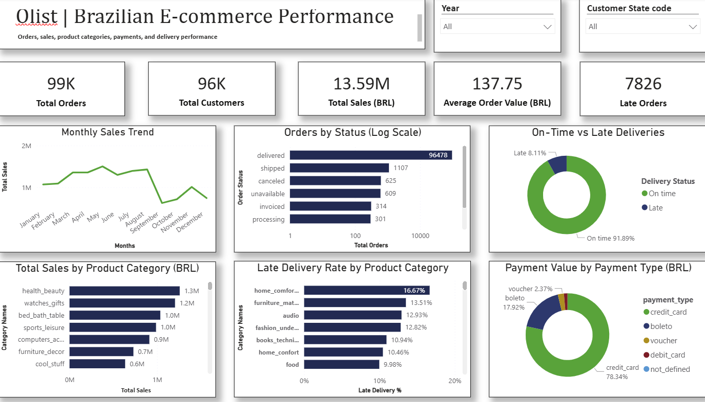
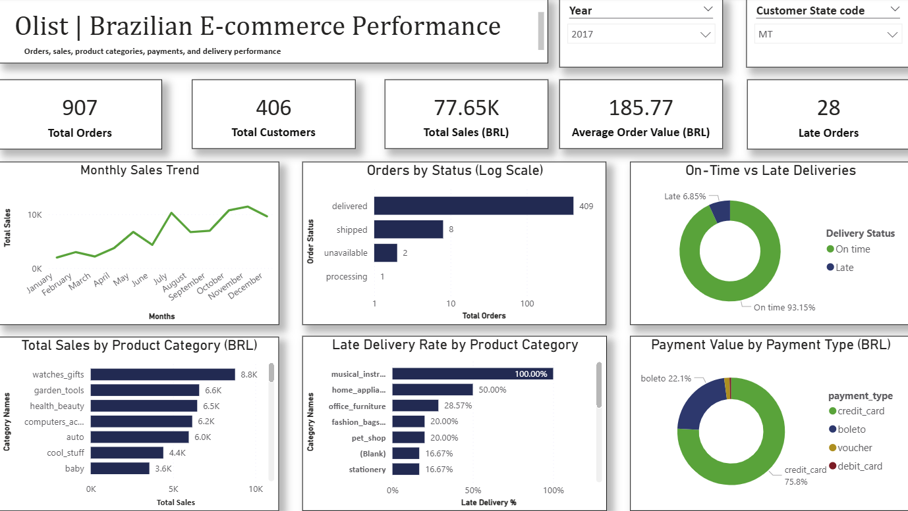
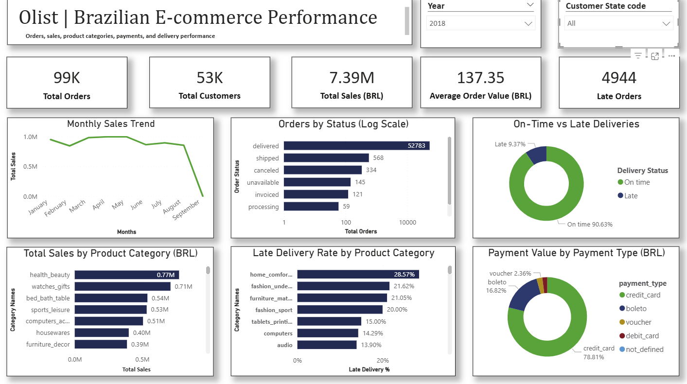

# Olist Brazilian E-Commerce Data Analysis


## Project Overview


This project explores the Olist Brazilian E-Commerce dataset using **MySQL** and **Power BI**. It combines SQL-based exploration with dashboard visualisations to examine order activity, product-item sales, customer activity, payment methods, and delivery performance.


The work began with exploratory business questions rather than a single predefined business problem. The SQL queries were used to investigate different aspects of the dataset, and selected results were used to build the Power BI dashboard.


## Project Objectives


- Explore e-commerce order and product-item data using MySQL.

- Investigate customer, product category, payment, seller, and delivery patterns.

- Use SQL techniques to answer analytical questions and calculate business metrics.

- Present selected findings through Power BI dashboard screenshots.

- Investigate an unusual result in the monthly sales trend using the underlying tables.


## Tools Used


- **MySQL** — data loading, querying, joins, aggregations, CTEs, subqueries, and window functions.

- **Power BI** — data modelling, DAX measures, slicers, and dashboard visualisation.


## Dataset


The project uses the public **Olist Brazilian E-Commerce dataset**.


- **Source:** [Olist Brazilian E-Commerce Dataset on Kaggle](https://www.kaggle.com/datasets/olistbr/brazilian-ecommerce)

- The dataset contains multiple related tables covering customers, orders, order items, payments, reviews, products, sellers, geolocation, and product category names.


The original CSV files are not included in this repository. Download them from the dataset source before running the SQL setup script.


## Repository Structure


```text

olist-ecommerce-data-analysis/

├── README.md

├── sql/

│   ├── Olist_Setup.sql

│   └── Olist_Queries.sql


├── investigation/

│   └── September_2018_Sales_Investigation.md

└── screenshots/

    ├── dashboard_overview.png

    └── dashboard_filtered_2017_MT.png

```


## Data Loading and Data Quality Notes


The dataset was loaded into MySQL using `LOAD DATA LOCAL INFILE` to bulk-load the CSV files.


During setup, local file loading had to be enabled because it was initially disabled in the MySQL environment. The server setting was enabled with `SET GLOBAL local_infile = 1`; depending on the MySQL client or Workbench connection configuration, local file loading also had to be permitted on the client side.


The source data also contained zero-date datetime values. These values caused problems under strict SQL date validation, so invalid zero dates were cleaned up and represented as `NULL` before continuing with the analysis and relationship setup.


For anyone reproducing the project, the exact settings and steps may differ by MySQL version and client configuration. Enable local file loading only in an environment where you are permitted to do so, and review the import statements and date-cleaning steps in `SQL/Olist_Setup.sql` before running the script.


## SQL Analysis


The SQL analysis contains **36 exploratory questions organised into five sections**. The questions cover areas such as:


- Orders and sales

- Payments and customer behaviour

- Product and category performance

- Order delivery performance

- Seller performance


The query file demonstrates the use of SQL joins, aggregations, conditional logic, CTEs, subqueries, `EXISTS` / `NOT EXISTS`, and window functions to explore the dataset and answer the selected questions.


See [`SQL/Olist_Queries.sql`](SQL/Olist_Queries.sql) for database and table setup, and [`SQL/Olist_Queries.sql`](SQL/Olist_Queries.sql) for the analysis queries.


## Power BI Dashboard


The Power BI dashboard is presented here through screenshots because the PBIX file is not included. The screenshots show selected measures and trends, including:


- Total sales based on product-item prices

- Distinct customers and orders

- Average product-item sales value per order represented in the order-items table

- Monthly sales trend

- Sales by product category

- Order status distribution

- On-time versus late delivery performance

- Late-delivery rates by product category

- Payment value by payment type

- Year and customer-state slicers


### Dashboard Screenshots


#### Dashboard Overview





#### Filtered Dashboard — 2017 and Mato Grosso (MT)





The second screenshot illustrates how the dashboard visuals respond to the selected year and state filters. Values in the filtered view apply to that selection, not to the entire dataset.


## Key Findings


The following findings are based on the dashboard values and visuals reviewed for this project:


- **Recorded product-item sales:** BRL 13.59 million.

- **Orders:** Approximately 99K distinct orders in the dashboard.

- **Unique customers:** Approximately 96K.

- **Average order value:** BRL 137.75, calculated as product-item sales divided by distinct order IDs represented in the order-items table.

- **Delivery performance:** 91.89% on time and 8.11% late among eligible orders represented in the order-items table.

- **Product categories:** Health & Beauty is the leading sales category among those displayed in the overall dashboard.

- **Payment methods:** Credit cards account for the largest displayed share of payment value (78.34%).

- **Monthly trend:** September 2018 shows an unusually low recorded product-item sales value and was investigated separately.


These are descriptive findings from this dataset and dashboard. They do not, on their own, establish causes or prove broader business trends.


## Metric Definitions and Scope


To make the dashboard figures interpretable, the main measures are defined as follows:


- **Total Sales:** `SUM(fact_order_items[price])` — sum of product-item prices. This is not necessarily the same as total payment revenue or total order value including freight and other charges.

- **Total Customers:** `DISTINCTCOUNT(dim_customer[customer_unique_id])` — count of unique customer identifiers in the customer dimension, subject to report filters.

- **Total Orders:** `DISTINCTCOUNT(fact_orders[order_id])` — distinct order IDs in the orders table, subject to report filters.

- **Orders With Sales:** `DISTINCTCOUNT(fact_order_items[order_id])` — distinct order IDs represented in the order-items table.

- **Average Order Value:** `[Total Sales] / [Orders With Sales]` — average product-item sales value per order represented in the order-items table. This definition excludes orders without corresponding order-item records and does not add freight or other payment components.

- **Delivery Status:** Delivered orders with both actual and estimated delivery dates are classified as **Late** if actual delivery occurred after the estimated date, otherwise **On time**. Other orders or orders with missing dates are left unclassified.

- **Late Orders / Eligible Delivered Orders:** These measures count distinct orders classified as late or as either late/on time, respectively, while restricting the counts to order IDs represented in the order-items table.


Consequently, the on-time and late-delivery percentages describe eligible orders with corresponding order-item records and usable delivery dates, rather than necessarily every order in the dataset.


## September 2018 Sales Investigation


During validation of the monthly sales trend, September 2018 showed an unusually low recorded product-item sales value of **145**. The `Orders` and `Order Items` tables were cross-checked using MySQL.


Key findings:


- September contained 16 orders, of which 15 were cancelled.

- The remaining shipped order had a recorded product price of 145.

- None of the 15 cancelled orders had matching records in the `Order Items` table.

- The Power BI measure `SUM(fact_order_items[price])` was consistent with the underlying data.


The unusually low recorded sales value is consistent with the limited number of orders that had corresponding order-item records during the period examined. This result should not be interpreted as evidence of an overall business-performance decline without further validation.


### September 2018 Investigation Screenshot

Investigated the sharp decline in recorded sales to BRL 145 in September 2018. The analysis found 16 orders: 15 cancelled and 1 shipped. The cancelled orders had no matching records in the `order_items` table.



See [`Investigation/September_2018_Sales_Investigation.md`](Investigation/September_2018_Sales_Investigation.md) for the separate investigation note.


## How to Reproduce the Analysis


1. Download the Olist dataset CSV files from the [Kaggle dataset page](https://www.kaggle.com/datasets/olistbr/brazilian-ecommerce).

2. Open `SQL/Olist_Setup.sql` and update the file paths in the data-loading statements to match the location of the downloaded CSV files.

3. Run the setup script in a MySQL environment configured to allow local file loading, where permitted by your environment.

4. Run `SQL/Olist_Queries.sql` to explore the questions and results.

5. Preview the dashboard using the screenshots below. The PBIX file is not included in this repository.


The setup script may require adjustments for your MySQL version, local file-loading permissions, and file paths.


## Limitations


- This is an exploratory analysis of the available dataset, not a causal study.

- Total Sales is based on product-item prices and should not be treated as total payment revenue.

- Average Order Value uses distinct orders represented in the order-items table as its denominator.

- Delivery percentages are calculated only for eligible delivered orders with usable dates and corresponding order-item records.

- The September 2018 investigation explains the observed figure within the records examined; it does not establish an overall business-performance trend or its cause.

- Dashboard findings depend on the dataset, model relationships, DAX definitions, and active report filters.


## Conclusion


This project demonstrates an end-to-end exploratory workflow using MySQL and Power BI. SQL was used to investigate order, customer, product, payment, seller, and delivery patterns, while screenshots present selected dashboard results. A separate SQL investigation was used to examine the unusually low recorded product-item sales value in September 2018.


Together, the query file, dashboard, and investigation note document the analytical process and its findings while making the definitions and limitations of the reported metrics explicit.


